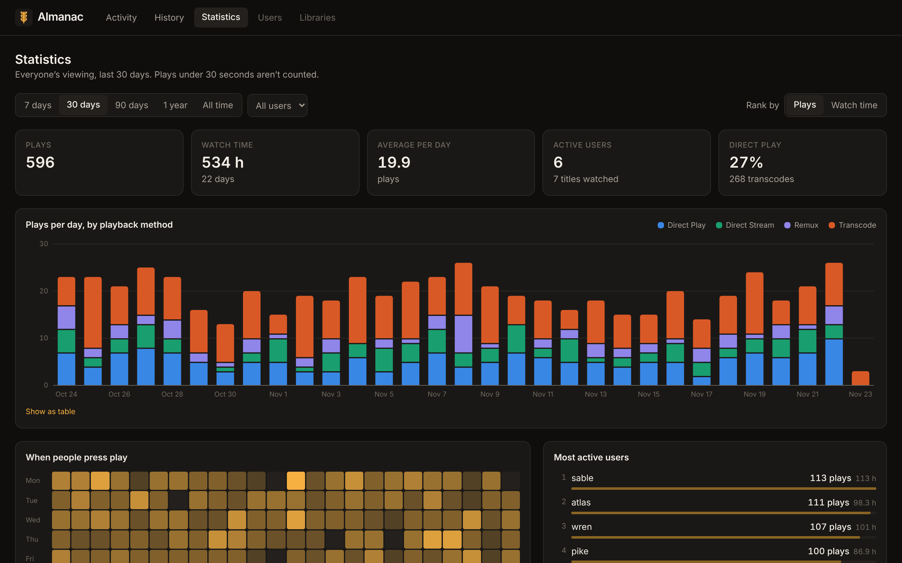
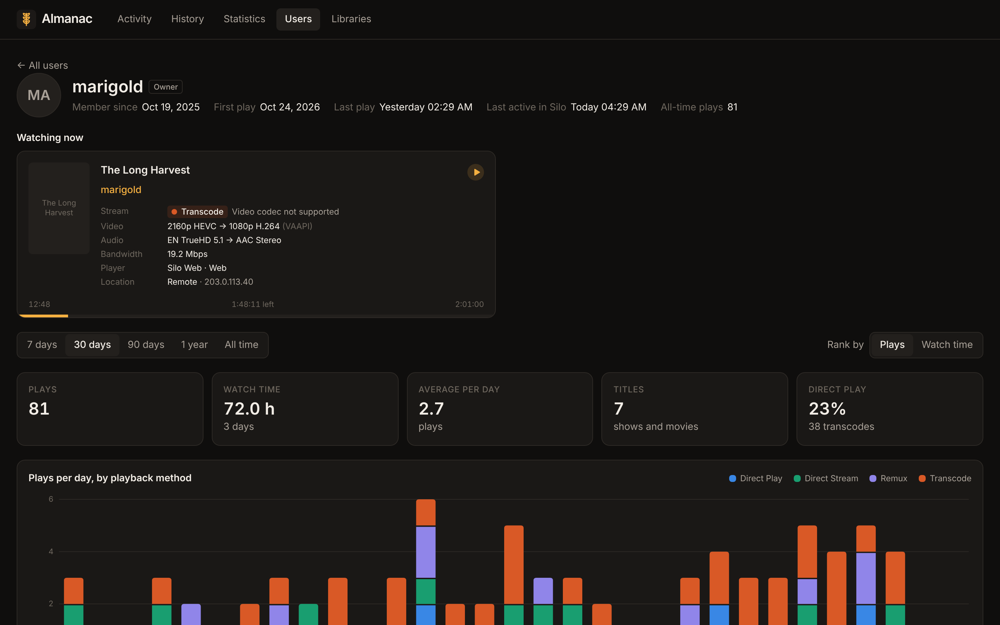
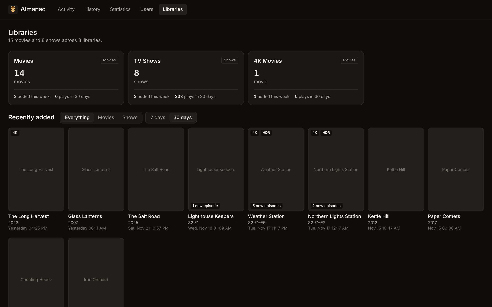

# Almanac

**Monitoring, history and statistics for your [Silo](https://siloserver.org) media server.**

Almanac is a self-hosted companion dashboard for Silo. It shows who is watching what right now, keeps a permanent record of every play, and turns that history into stats and graphs.

> [!WARNING]
> Almanac is in early development. Silo itself is pre-release, and its API may change before 1.0. Silo itself is pre-release, and its API may change before 1.0.








## Features

### Live activity ✅
- A server overview at the top: profiles that watched in the last 24 hours, total movies and shows, and Silo's version, uptime, Postgres and Redis health and nodes
- Every active stream on one page, with poster, user, player, IP address and live progress
- Totals for streams, playback methods and bandwidth
- Search, filter by playback method, and sort
- Direct play, remux or transcode, with Silo's reason for each transcode
- Source and target resolution, and whether the stream is local or remote
- Updates every few seconds without reloading the page

### History ✅
- A permanent, searchable log of every play, kept in Almanac's own database
- Imports all of Silo's existing history on first start, then keeps up as plays finish
- Keeps usernames and titles even after Silo deletes the account or item
- Filter by user, type, playback method, platform or period, and search by title, user, player or IP address
- Detail for each play: time actually watched, pauses, start and end position, player, IP address and why it ended
- Hides plays under 30 seconds by default

### Statistics ✅
- Totals for plays, watch time, active users, plays per day and the share of direct play
- Plays per day (or per week for long periods), split by playback method, with a table view
- A heatmap of when people press play, by day of the week and hour, in your time zone
- Top shows, movies, users, platforms and players, ranked by plays or by watch time
- For the last 7, 30 or 90 days, the last year or all time, for everyone or one user
- **Viewer map:** which countries people watch from, and (admins only) which cities. Looked up on your own server with a free copy of DB-IP's database, so no addresses are sent anywhere

### Users ✅
- Every account, with its email to make people easy to recognise, combining Silo's details (role, enabled, member since, last active) with plays, watch time, last watched, top platform and direct-play share
- Search by name or email, sort, and filter by recent activity or disabled accounts
- A page for each user: what they're watching now, their charts and top titles, recent plays, the players, IP addresses and profiles they use, their offline downloads and every device signed in to the account

### Libraries ✅
- **Trending:** what's rising this week, the most-watched titles by viewers, and shows people are bingeing right now
- Every library with its movie or show count, items added this week and plays in the last 30 days
- A poster grid of recently added movies and shows, with new episodes grouped by show and 4K and HDR badges
- Filter by library, movies or shows, and the last 7 or 30 days

### Moderation ✅
- **Account flags**, checked every 5 minutes over the last 7 days:
  - *Possible account sharing:* 3 or more different networks at the same time, 10 or more networks in a week, 7 or more devices in a week, 15 or more devices signed in to the account and used in the last 30 days, or *impossible travel* on 4 or more days in a week (two different devices playing over 300 miles apart, closer together in time than anyone could travel)
  - *Non-stop playback* (restreaming, or a TV left on): 24 hours or more without a break, or 12 or more hours a day on average
  - *Possible ripping:* 40 or more offline downloads (or 200 GB or more) in a week; or 8 or more hours of titles watched to the end back to back with no pauses (never more than "worth a look" on its own, since autoplay with the TV left on looks the same). Titles skipped through to the end don't count; or 40 or more different movies and shows opened in a day and left with under 2 minutes watched (a show's episodes count once), which is how a tool scanning or copying the library looks
- Severity on each flag (minor, worth a look, serious), with the evidence and when it happened
- *Mark as reviewed* with a note; a reviewed flag reopens if the behaviour gets clearly worse
- **Exceptions:** allow an account something that would otherwise be flagged (a family in two houses, downloads before flights), for 30 days, 90 days, a year or until removed, with a reason other mods can see. Choose whether serious flags of that kind still show. Add one from a flag (*Allow this…*) or the user's page; the Moderation page lists them all
- **Case file** for every account: flags (including ones that went quiet), notes, suspension requests and exceptions with a timeline, on one page, with *Copy as text* for pasting into Discord or the billing portal
- "On 3 networks now" badges on Activity while it's happening
- **Adjustable thresholds** (admins, in Settings): turn checks on or off and change their levels, with a live preview of how many accounts would be flagged
- Shared **notes** and **tags** on any user (for example VIP, Family, Warned), with tags shown next to their name everywhere

Networks are compared rather than exact IP addresses (IPv4 /24, IPv6 /64, and all private addresses count as one home network), so phones changing address don't cause flags. A device only counts in one place at a time, a stream that timed out stops counting 10 minutes before Silo gave up on it, and web browsers count as one device per network, so a phone switching from Wi-Fi to mobile data or a cleared browser doesn't look like sharing. Flags for streams at the same time say which countries they were in (and which towns, for admins). Mods see the counts and evidence but never the addresses.

**VPNs:** Almanac looks up who operates each address (DB-IP's free ASN database, on your own server). VPN services run on data-centre networks (M247, Datacamp, PacketHub, Proton and so on), not home or mobile broadband, so a VPN can be told apart from a household. Every VPN server counts as one network, and impossible travel ignores VPN locations, since a VPN server's location says nothing about where the viewer is. Activity shows a **VPN** badge; admins also see the operator on Activity, History and user pages. Plays from players that never report progress still count for the sharing checks (not for playback time), and players that don't say what they are show as **Unknown app**.

### Yearly recap ✅
- A "year in review" for each user and for the whole server: hours watched, plays, movies, episodes and active days
- Top shows and movies with posters, favourite genre, watch time by month and a heatmap of when they watch
- Fun facts: biggest binge, longest sitting, longest daily streak, busiest day, favourite device, first play of the year
- How a user compares with everyone else that year, and the server's biggest viewers and titles added
- Open it from the Statistics page or any user's page
- **Share links:** admins and mods can make a link that shows one recap to anyone, without signing in, and turn it off at any time. Shared recaps leave out usernames of other viewers and server details

### Server ✅
- **Load:** streams and bandwidth over the last day, week, month, 3 months or year, with peaks, and a heatmap of a typical week so you can plan maintenance in the quiet hours
- **Capacity:** each evening's peak streams, upload bandwidth and transcodes over the last 8 weeks, the trend, and (once you enter what your servers can handle) when busy evenings will reach those limits. One unusual night doesn't skew it. Staff Discord is told as a limit gets close
- **Nodes:** each Silo node with its status, version, streams and bandwidth
- **Transcode doctor:** why streams are being converted, which players and files cause it most, and suggestions for fixing it
- **Reliability:** how many streams drop (the player stopped answering mid-stream) or stop within 10 seconds, compared with what's usual, by player and by playback method, alongside Silo's count of streams watched to the end. **Viewers having a rough time** lists people whose streams drop or stop far more than everyone else's, or are nearly all converted, compared with other people on the same apps (phones drop more than TVs for everyone). It names the actual device where Silo reports it (Fire TV Stick 4K Max, NVIDIA Shield, Chromecast, onn, TCL and Sony TVs, Roku, Apple TV and more) and gives steps for that device: how to restart it, wire it, clear its cache, or which formats it can't play. Apps that never tell Silo when playback stops aren't counted for drops, and titles watched to the end never count as dropped. Each user's page has the same breakdown. Admins can have a staff Discord channel alerted when drops jump, and when new account flags appear (with the account's email and a link, never IP addresses)
- **Downloads:** what people have downloaded in Silo's apps for offline viewing, the biggest downloaders, and what's on devices now. Almanac keeps its own record, so deleted downloads still count

### Discord notifications ✅ (admins)
- Newly added movies and episodes posted to Discord, with a separate webhook for each channel and any mix of libraries per channel
- Only post 4K, HDR or Dolby Vision copies, so a Dolby Vision channel can watch your 4K libraries
- A 4K copy of an existing movie counts as new in the 4K library
- Posters, summaries, ratings, runtime, quality (resolution, HDR and edition) and links, from TMDB for movies and TVDB for shows (free keys, entered on the page). Without keys, posts use Silo's details
- A show's new episodes are grouped into one post; a big import becomes one summary instead of hundreds of posts
- Waits a little for Silo to match a new file, so posts have the right title and poster
- A test button, a log of recent posts, and channels turn themselves off (with a note) if their webhook is deleted

- **Server status:** one message showing each server on an Uptime Kuma status page with a coloured dot and its uptime today (🟢 Emby 1: 100% today), or how long it has been down, edited every 2 minutes. Works behind Cloudflare Access with a service token
- **Library counts:** one message in a channel of your choice listing every library and how much is in it (with new films and episodes this week), edited every hour so the channel never fills up. Choose which libraries to show

### Later
- Notifications for other events and services
- Recently added newsletters

## How it works

Almanac connects to Silo with a read-only API key owned by a Silo administrator.

- **Activity:** every few seconds Almanac asks Silo for the current playback sessions and pushes changes to open dashboards straight away.
- **Users and libraries:** every few minutes Almanac refreshes Silo's account list and library names and fetches newly added items. Every 12 hours it re-reads all movies and shows. The first copy of a large catalog takes a few minutes.
- **History:** Almanac copies Silo's play history into its own SQLite database. The first start imports everything Silo has, newest first. On a busy server this can take a while, and the History page shows progress as it goes. After that, Almanac fetches new plays every minute, and within seconds of a stream ending.

```
                        ┌──────────────────────┐
Silo server ──REST API──▶ Almanac server       │──live updates──▶ Your browser
                        │  └─ SQLite (/data)   │
                        └──────────────────────┘
```

## Getting started

### 1. Create a Silo API key

1. Log in to Silo as an administrator.
2. Open the API keys section of the admin settings.
3. Create a key called `Almanac` with only the **`admin:monitor:read`** and **`libraries:read`** scopes. Both are read-only. Without `libraries:read`, everything works but libraries show as numbers instead of names.
4. Copy the key, which starts with `sa_`. Silo only shows it once.

### 2. Install

**The quick way**, on a Linux server (it installs Docker if needed, sets up HTTPS, and keeps your data on re-runs):

```bash
curl -fsSL https://raw.githubusercontent.com/daskaputtja/Almanac/main/deploy/install.sh -o install-almanac.sh
sudo bash install-almanac.sh
```

It asks for Almanac's address, your Silo address and the API key, then prints the setup code for step 3. Before running it, point a DNS **A record** for Almanac's address at the server.

To update later, run `sudo almanac-update`. It downloads the latest version and restarts Almanac in about a minute, keeping your settings, accounts and history. The installer can also set it to update itself every night. If you installed by hand, run `docker compose pull && docker compose up -d` instead.

**Or by hand** with Docker Compose:

```yaml
services:
  almanac:
    image: ghcr.io/daskaputtja/almanac:latest
    container_name: almanac
    restart: unless-stopped
    ports:
      - "8191:8191"
    environment:
      SILO_URL: https://silo.example.com
      SILO_API_KEY: sa_your_key_here
    volumes:
      - ./almanac-data:/data
```

### 3. Create your account

1. Find the setup code in Almanac's log:
   ```bash
   docker logs almanac
   ```
   Look for `You'll need this setup code: XXXX-XXXX-XXXX`. A new code is printed each time Almanac starts, until the first account exists.
2. Open `http://your-server:8191`, enter the setup code, and choose a username and password (at least 12 characters).
3. Scan the QR code with an authenticator app (Google Authenticator, Microsoft Authenticator, Authy, 1Password, Bitwarden and so on), then type in the 6-digit code it shows.
4. Save your 10 recovery codes somewhere safe. Each one signs you in once if you don't have your phone.

From then on, signing in needs your password and a code from the app.

The `/data` volume holds Almanac's database. Keep it, or Almanac will have to import your history again and will lose any plays Silo has since removed.

### Settings

| Variable | Required | Default | What it does |
|---|---|---|---|
| `SILO_URL` | Yes | | Your Silo server's address, e.g. `https://silo.example.com` |
| `SILO_API_KEY` | Yes | | The API key from step 1 |
| `TRUST_PROXY` | No | `false` | Set to `true` behind a reverse proxy, so Almanac sees visitors' real IP addresses and HTTPS |
| `GEOLOCATION` | No | `on` | Set to `off` to turn off the viewer map. When on, Almanac downloads DB-IP's free city database (about 130 MB) and network operator database (about 10 MB) once a month. Off also turns off VPN detection |
| `SECURE_COOKIES` | No | `auto` | `auto` marks the sign-in cookie HTTPS-only when the request came over HTTPS; or `always` / `never` |
| `ALMANAC_USERNAME` | No | | Creates the first account on startup instead of using the setup page. You still set up 2FA at first sign-in |
| `ALMANAC_PASSWORD` | No | | The password for that account |
| `PORT` | No | `8191` | The port Almanac listens on |
| `POLL_INTERVAL_SECONDS` | No | `5` | How often to ask Silo for activity |
| `HISTORY_SYNC_SECONDS` | No | `60` | How often to fetch new plays from Silo |
| `CATALOG_SYNC_MINUTES` | No | `5` | How often to refresh accounts, libraries and newly added items |
| `DATA_DIR` | No | `data` (`/data` in Docker) | Where Almanac keeps its database |
| `SILO_MOCK` | No | `false` | Set to `true` to show made-up demo data instead of a real server |

> [!IMPORTANT]
> Almanac shows usernames and IP addresses. If it can be reached from the internet, put it behind HTTPS (for example your existing reverse proxy) and set `TRUST_PROXY=true`.

## Accounts and roles

| | Admin | Mod |
|---|---|---|
| Activity, History, Statistics, Users, Libraries | ✅ | ✅ |
| Viewers' IP addresses (and searching by IP) | ✅ | ❌ |
| Moderation: flags, notes and tags | ✅ | ✅ |
| Which networks a flagged account used | ✅ | ❌ |
| Edit or delete other people's notes | ✅ | ❌ |
| Notification settings (Discord and others) | ✅ | ❌ |
| Add, change and remove accounts | ✅ | ❌ |
| Ask for an account to be suspended or unsuspended (with a reason) | ✅ | ✅ |
| Approve or reject suspension requests, and suspend directly | ✅ | ❌ |
| Connect the billing portal (and its API key) | ✅ | ❌ |

The first account is an admin. Admins manage accounts in **Settings → Accounts**: add an account with a starting password and a role, change roles, reset someone's 2FA or password, or delete an account. Every change needs the admin's own 2FA code. New accounts set up their own 2FA at first sign-in. Almanac won't let you delete or demote the last admin.

For mods, IP addresses are removed on the server before anything is sent, so they can't be found in the page or the API.

## Billing portal (suspending accounts)

Almanac doesn't suspend accounts itself: its Silo key is read-only. Instead it asks your billing portal, which already turns Silo accounts off and on for non-payment.

- A **mod** presses *Suspend until they get in touch* (or *Lift the suspension*) on a user's page and writes a reason. The request waits on the Moderation page for an admin, and the staff Discord channel is told.
- An **admin** approves it (Almanac sends it to the portal) or rejects it (with a reason). An admin's own requests go straight to the portal.
- Every step is written to the account's notes: who asked, why, who approved, and what the portal said.
- **Automatic requests** (optional, Settings → Automatic suspension requests): when a chosen check reaches *Serious* (offline downloads, titles opened but not watched, hours without a break, hours a day, networks at the same time), Almanac files the request itself, as *Almanac (automatic)*, with the evidence as the reason. It waits for an admin like any other: nothing happens to the account until someone approves it. Accounts with an exception for that kind of flag are left alone.

Set it up in **Settings → Billing portal**: the address Almanac should send requests to, and a shared signing secret (*Generate one* makes a strong one; put the same value in your portal). *Send a test* sends a `ping`.

### What your portal receives

`POST` to the address you set, with a JSON body:

```json
{
  "event": "suspend",
  "request_id": 12,
  "user": { "silo_id": "42", "username": "example-user", "email": "someone@example.com" },
  "reason": "Over 100 offline downloads in a week, all original quality.",
  "requested_by": "morgan",
  "approved_by": "sam",
  "sent_at": "2026-11-24T11:55:49.077Z"
}
```

`event` is `suspend`, `unsuspend` or `ping` (a test, with no `user`). Two headers sign it:

- `X-Almanac-Timestamp`: Unix time in seconds.
- `X-Almanac-Signature`: `sha256=` followed by the hex HMAC-SHA256 of `timestamp + "." + raw body`, keyed with the shared secret.

Your portal should:

1. **Check the signature** over the raw body, with a constant-time comparison, and reject timestamps more than 5 minutes old. Answer `401` if either fails.
2. **Find the customer** by `silo_id`, `username` or `email`. Answer `404` with `{"error": "..."}` if there isn't one.
3. **Do it**: disable or re-enable the Silo account the same way it does for non-payment, and (if you like) show the customer a "please contact us" notice. Treat repeats as success, so suspending someone already suspended is fine.
4. **Answer `200`** with `{"message": "..."}`. Almanac shows the message to staff and saves it in the notes.

Example check in Node.js (Express):

```js
import crypto from 'node:crypto';
import express from 'express';

const app = express();
app.post('/almanac/suspensions', express.raw({ type: 'application/json' }), (req, res) => {
  const timestamp = req.get('X-Almanac-Timestamp') ?? '';
  const expected = 'sha256=' + crypto.createHmac('sha256', process.env.ALMANAC_SECRET).update(`${timestamp}.${req.body}`).digest('hex');
  const given = req.get('X-Almanac-Signature') ?? '';
  const fresh = Math.abs(Date.now() / 1000 - Number(timestamp)) < 300;
  if (!fresh || given.length !== expected.length || !crypto.timingSafeEqual(Buffer.from(given), Buffer.from(expected))) {
    return res.status(401).json({ error: 'Bad signature' });
  }
  const event = JSON.parse(req.body);
  if (event.event === 'ping') return res.json({ message: 'pong' });
  // Find the customer by event.user.silo_id / username / email, then suspend or reactivate them.
  res.json({ message: `Customer ${event.user.email} ${event.event === 'suspend' ? 'suspended' : 'reactivated'}` });
});
```

The same check in PHP:

```php
$body = file_get_contents('php://input');
$timestamp = $_SERVER['HTTP_X_ALMANAC_TIMESTAMP'] ?? '';
$expected = 'sha256=' . hash_hmac('sha256', $timestamp . '.' . $body, getenv('ALMANAC_SECRET'));
$given = $_SERVER['HTTP_X_ALMANAC_SIGNATURE'] ?? '';
if (abs(time() - (int) $timestamp) > 300 || !hash_equals($expected, $given)) {
    http_response_code(401);
    exit(json_encode(['error' => 'Bad signature']));
}
$event = json_decode($body, true);
// ...
```

Use HTTPS for the portal's address: the request carries the customer's email and the reason.

### Flags sent to your portal

If **Settings → Billing portal → Send new flags to the portal** is on, new flags at the chosen level (or above) reach the same address, signed the same way, as a `flag` event. Answer `200`; anything else is logged and not retried.

```json
{
  "event": "flag",
  "customer": { "id": "42", "username": "example-user", "email": "someone@example.com" },
  "flag": {
    "reason": "new",
    "kind": "bulk_opening",
    "group": "ripping",
    "severity": "high",
    "headline": "Opened 244 different titles in a day without watching them",
    "details": ["Between 2026-11-19T12:33:00.000Z and 2026-11-20T12:28:00.000Z: 259 streams started, usually 6 seconds apart, …"]
  },
  "almanac_url": "https://almanac.example.com/users/42",
  "sent_at": "2026-11-26T08:25:00.000Z"
}
```

`reason` is `new`, `worse` (got more serious) or `reopened` (a reviewed flag came back). `group` is `sharing`, `nonstop` or `ripping`; `severity` is `low`, `medium` or `high`.

## Portal API

The other direction: your portal calls Almanac. Make a key in **Settings → Billing portal → Portal API** (admins only; it's shown once, and *Make a new key* or *Turn the key off* stops the old one at once). Send it on every request:

```
Authorization: Bearer alm_…
```

Everything is JSON under `/api/portal/v1`. The portal never gets IP addresses. Errors are `{"error": "..."}` with `400` (bad input), `401` (wrong or missing key), `404` (no such customer) or `429` (too many wrong keys from one address).

| Request | What it does |
|---|---|
| `GET /api/portal/v1` | Checks the key: `{"app": "almanac", "apiVersion": 1}` |
| `GET /api/portal/v1/customers?email=…` (or `?username=…`, `?id=…`) | One customer's summary, found by email, username or Silo ID (not case-sensitive) |
| `GET /api/portal/v1/customers/{id}` | The same, by Silo ID |
| `GET /api/portal/v1/customers/{id}/usage?days=30` | Usage over 1 to 365 days |
| `GET /api/portal/v1/usage?days=30` | Usage for every customer, for billing runs |
| `POST /api/portal/v1/events` | Tell Almanac what the portal did; it's written to the customer's notes |

A customer summary:

```json
{
  "customer": {
    "id": "42",
    "username": "example-user",
    "email": "someone@example.com",
    "enabled": true,
    "createdAt": "2026-01-20T10:00:00.000Z",
    "lastActiveAt": "2026-11-26T08:10:00.000Z",
    "lastPlayedAt": "2026-11-26T07:55:00.000Z",
    "watchingNow": 1,
    "usage": {
      "days": 30, "plays": 85, "hoursWatched": 61.5, "activeDays": 22,
      "peakStreams": 2, "peakStreamsAt": "2026-11-21T20:14:00.000Z",
      "devicesUsed": 4, "devicesSignedIn": 6,
      "downloads": 3, "downloadGb": 12.4,
      "vpnShare": 0.1
    },
    "mainDevice": "Fire TV Stick 4K Max (2021)",
    "playback": { "status": "struggling", "issues": ["38 of 85 streams dropped (45%; about 6% for others on the same apps)"] },
    "flags": [{ "kind": "many_networks", "group": "sharing", "severity": "low", "headline": "Used 11 different networks in 7 days", "since": "2026-11-20T18:00:00.000Z", "reviewed": false }],
    "exceptions": [{ "group": "sharing", "until": "2027-02-24T00:00:00.000Z", "reason": "Family in two houses" }],
    "pendingSuspension": null,
    "almanacUrl": "https://almanac.example.com/users/42"
  }
}
```

- `peakStreams`: the most streams playing at the same moment on different devices (a stream that timed out stops counting 10 minutes before Silo gave up on it). Use it to check a plan's stream limit.
- `devicesUsed`: devices that played something; `devicesSignedIn`: devices signed in to the account in Silo and used in the period.
- `vpnShare`: the share of plays over a VPN or data-centre network (0 to 1), or `null` when it isn't known yet.
- `playback.status`: `fine`, `struggling` or `unknown` (too few plays), as on Server → Reliability.

Telling Almanac what the portal did:

```json
POST /api/portal/v1/events
{ "customer": { "email": "someone@example.com" }, "type": "suspended", "detail": "Payment failed twice" }
```

`customer` takes `id`, `username` or `email`. `type` is `suspended`, `reactivated`, `payment_failed`, `plan_changed` (add `"plan": "4 streams"`), `cancelled` or `note` (needs `detail`). It's written to the customer's notes as *Billing portal*, for example "Suspended: Payment failed twice", so it shows on their page and in their case file. The answer is `201` with `{"ok": true, "userId": "42", "note": "…"}`.

Example (Node.js):

```js
const res = await fetch('https://almanac.example.com/api/portal/v1/customers?email=' + encodeURIComponent(email), {
  headers: { Authorization: `Bearer ${process.env.ALMANAC_PORTAL_KEY}` },
});
const { customer } = await res.json();
if (customer.usage.peakStreams > plan.streams) { /* over their plan's limit */ }
```

## WHMCS

If your customers are billed with WHMCS, Almanac can suspend and unsuspend their Silo service through WHMCS's own API, with nothing to install on the WHMCS side. WHMCS then does what it always does when a service is suspended: the status, emails, client area, and the product's provisioning module, which is what actually turns the Silo account off.

> If your Silo product in WHMCS has no provisioning module (a manual product), WHMCS only marks the service suspended; someone still has to turn the Silo account off by hand. Check this before relying on it.

**Set up in WHMCS**

1. **System Settings → Manage API Credentials → API Roles:** make a role allowing `GetClientsProducts`, `GetClientsDetails`, `ModuleSuspend` and `ModuleUnsuspend`.
2. **Manage API Credentials → API Credentials:** make credentials for an admin user with that role. Note the identifier and secret.
3. **System Settings → General Settings → Security tab → API IP Access Restriction:** add your Almanac server's IP address (or use an API access key from WHMCS's `configuration.php` instead).
4. Note the product ID of each Silo plan (**System Settings → Products/Services**, in the product's address as `id=`).

**Set up in Almanac:** **Settings → Billing portal → WHMCS**: WHMCS's address, the identifier and secret, how to match customers (the service's username, which is usually the Silo username, then the client's email), and the Silo product IDs, so domains and other services are never touched. *Test the connection* checks it.

When an admin approves a suspension (or an automatic request), Almanac finds the customer's active Silo service(s) and runs **Module Suspend** with the reason (prefixed `Almanac:`). Lifting it runs **Module Unsuspend**. What WHMCS answered goes in the customer's notes, and a customer WHMCS can't find shows as *Didn't go through* with how Almanac looked, ready to try again.

**The hook file (optional).** [`deploy/whmcs/almanac.php`](deploy/whmcs/almanac.php) goes in WHMCS's `includes/hooks/` folder. Set Almanac's address, a [Portal API](#portal-api) key and your Silo product IDs at the top. It:

- shows an **Almanac panel on each client's summary page** in WHMCS admin: watching now or last watched, plays and hours, peak streams at once, devices, downloads, VPN use, playback, open flags, any pending suspension, and a link to them in Almanac;
- tells Almanac when **WHMCS** suspends, unsuspends, terminates or changes the package of a Silo service (non-payment, upgrades), so it's in the customer's notes and case file. Suspensions Almanac asked for are skipped, since they're noted already.

Every call to Almanac gives up after a few seconds, so WHMCS is never held up if Almanac is down.

## Security

- **Sign-in needs two things:** a password and a 6-digit code from an authenticator app (TOTP, RFC 6238). Two-factor authentication can't be turned off.
- **First-run protection:** creating the first account needs a setup code that is only printed in the server log, so someone who finds a fresh install can't claim it.
- **Passwords** are hashed with scrypt. **Recovery codes** and **session tokens** are stored only as hashes, so a copy of the database can't be used to sign in.
- **Each authenticator code works once.** Codes from up to 30 seconds either side are accepted, to allow for clock drift.
- **Sessions** use an `HttpOnly`, `SameSite=Lax` cookie (also `Secure` over HTTPS). They end after 7 days unused or 30 days at most. You can see and sign out sessions in Settings.
- **Failed attempts are limited:** 20 per IP address and 10 per username in 15 minutes. Five wrong codes on one sign-in sends you back to the password step.
- **Requests from other websites are refused.** Every request that changes something needs a header other sites can't send, and a matching `Origin`.
- **Every API route needs a session**, except `/api/health` for Docker's health check.
- **Security headers:** a strict Content Security Policy, no framing, and `no-referrer`.

### Locked out?

Use the recovery tool inside the container:

```bash
docker exec -it almanac almanac-cli users                    # list accounts
docker exec -it almanac almanac-cli reset-2fa <username>     # set up 2FA again at next sign-in
docker exec -it almanac almanac-cli reset-password <username>
docker exec -it almanac almanac-cli set-role <username> admin   # or mod
```

Both resets sign the account out everywhere. Outside Docker, use `npm run cli -- <command>`.

## Development

You need Node.js 22 or newer.

```bash
npm install
cp .env.example .env    # then fill in SILO_URL and SILO_API_KEY, or set SILO_MOCK=true
npm run dev             # opens the dashboard on http://localhost:5173
```

| Command | What it does |
|---|---|
| `npm run dev` | Runs the server and dashboard with live reload |
| `npm test` | Runs the tests |
| `npm run typecheck` | Checks types in the server and dashboard |
| `npm run build` | Builds everything into `dist/` |
| `npm start` | Runs the built app |

### Project layout

```
server/            The Almanac server (Hono on Node.js)
  silo/            Talking to Silo: API client, response types, demo data
  activity/        Turning Silo sessions into Almanac's activity view
  history/         Storing play history and syncing it from Silo
  stats/           Statistics calculated from the play history
  recap/           The yearly recap and share links
  load/            Server load history
  transcodes/      The transcode doctor
  trending/        Trending titles
  accounts/        Offline downloads and signed-in devices, copied from Silo
  reliability/     How reliably streams play, and the staff alert
  capacity/        Evening peaks, their trend, and when they reach the limits
  health/          Viewers whose streams are going badly, and why
  geo/             Looking up where viewers are
  notify/          Discord posts for recently added, and TMDB/TVDB lookups
  users/           Accounts combined with their play history
  library/         Copying Silo's catalog and the Libraries page's queries
  auth/            Accounts, passwords, two-factor codes, sessions and sign-in routes
  moderation/      Account flag checks, notes and tags (default thresholds are in shared/moderation.ts)
  cli.ts           The almanac-cli recovery tool
  db/              Opening the SQLite database and running migrations
shared/            Types shared by the server and the dashboard
web/               The dashboard (React, Vite, Tailwind)
test/              Tests (Vitest)
```

The dashboard never reads Silo's API responses directly. The server converts them into Almanac's own types (in `server/activity/map.ts` and `server/history/store.ts`), so when Silo's API changes, those are the only places that need fixing.

Database changes go in `server/db/database.ts` as a new numbered migration. Never edit one that has already shipped.

## Tech stack

- **Server:** TypeScript on Node.js with Hono
- **Sign-in:** built-in scrypt and TOTP, using Node's crypto module, plus `qrcode` for the setup QR code
- **Database:** SQLite, using Node's built-in `node:sqlite`
- **Dashboard:** React, Vite and Tailwind CSS
- **Tests:** Vitest
- **Deployment:** a single Docker image, built automatically and published to GitHub Container Registry

## Contributing

The project is just getting started. Issues and ideas are welcome.

## Licence

The viewer map uses [IP to City Lite](https://db-ip.com) by DB-IP, and VPN detection uses DB-IP's IP to ASN Lite with RouteViews data (via [ip-location-db](https://github.com/sapics/ip-location-db)), both licensed under [CC BY 4.0](https://creativecommons.org/licenses/by/4.0/).

[GNU Affero General Public License v3.0](LICENSE)

## Disclaimer

Almanac is an independent community project. It is not affiliated with or endorsed by Silo Media L.L.C. "Silo" and the Silo logo are trademarks of Silo Media L.L.C.
