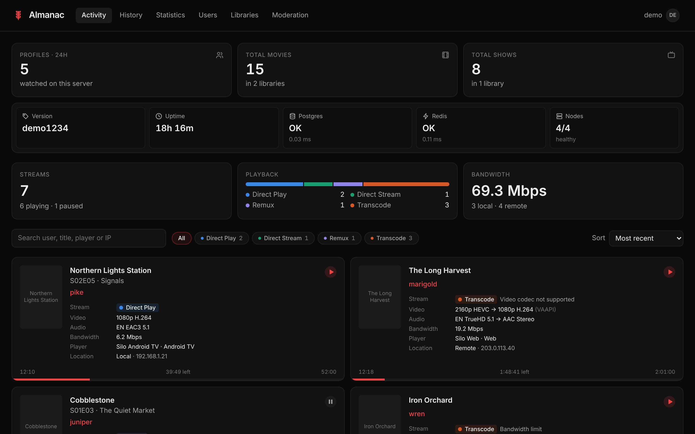
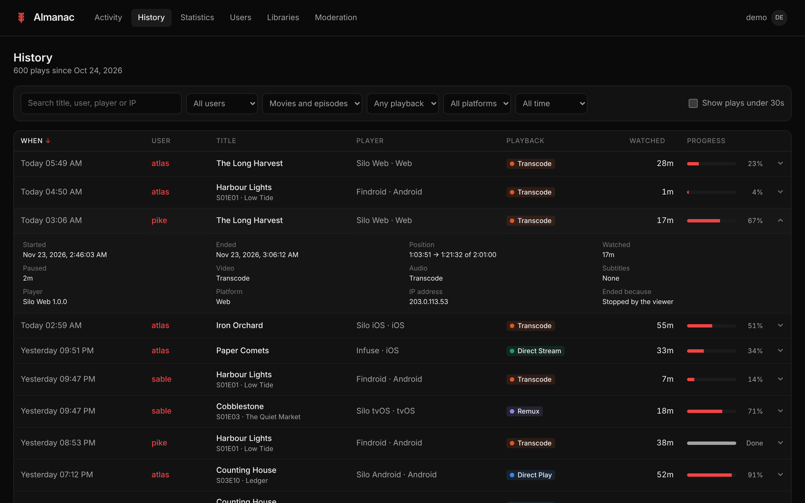

# Almanac

**Monitoring, history and statistics for your [Silo](https://siloserver.org) media server.**

Almanac is a self-hosted companion dashboard for Silo. It shows who is watching what right now, keeps a permanent record of every play, and turns that history into stats and graphs.

> [!WARNING]
> Almanac is in early development. Silo itself is pre-release, and its API may change before 1.0. Silo itself is pre-release, and its API may change before 1.0.






## Features

### Live activity ✅
- A server overview at the top: profiles that watched in the last 24 hours, total movies and shows, and Silo's version, uptime, Postgres and Redis health and nodes
- Every active stream on one page, with poster, user, player, IP address and live progress
- Totals for streams, playback methods and bandwidth
- Search, filter by playback method, and sort
- Direct play, remux or transcode, with Silo's reason for each transcode
- Source and target resolution, and whether the stream is local or remote
- Updates every few seconds without reloading the page

### History ✅
- A permanent, searchable log of every play, kept in Almanac's own database
- Imports all of Silo's existing history on first start, then keeps up as plays finish
- Keeps usernames and titles even after Silo deletes the account or item
- Filter by user, type, playback method, platform or period, and search by title, user, player or IP address
- Detail for each play: time actually watched, pauses, start and end position, player, IP address and why it ended
- Hides plays under 30 seconds by default

### Statistics ✅
- Totals for plays, watch time, active users, plays per day and the share of direct play
- Plays per day (or per week for long periods), split by playback method, with a table view
- A heatmap of when people press play, by day of the week and hour, in your time zone
- Top shows, movies, users, platforms and players, ranked by plays or by watch time
- For the last 7, 30 or 90 days, the last year or all time, for everyone or one user

### Users ✅
- Every account, combining Silo's details (role, enabled, member since, last active) with plays, watch time, last watched, top platform and direct-play share
- Search, sort, and filter by recent activity or disabled accounts
- A page for each user: what they're watching now, their charts and top titles, recent plays, and the players, IP addresses and profiles they use

### Libraries ✅
- Every library with its movie or show count, items added this week and plays in the last 30 days
- A poster grid of recently added movies and shows, with new episodes grouped by show and 4K and HDR badges
- Filter by library, movies or shows, and the last 7 or 30 days

### Moderation ✅
- **Account flags**, checked every 5 minutes over the last 7 days:
  - *Possible account sharing:* 3 or more different networks at the same time, 10 or more networks in a week, or 7 or more devices in a week
  - *Non-stop playback* (restreaming, or a TV left on): 24 hours or more without a break, or 12 or more hours a day on average
  - *Possible ripping:* 20 or more titles (or 5 or more movies) played to the end back to back with no pauses, or finished much faster than their running time
- Severity on each flag (minor, worth a look, serious), with the evidence and when it happened
- *Mark as reviewed* with a note; a reviewed flag reopens if the behaviour gets clearly worse
- "On 3 networks now" badges on Activity while it's happening
- **Adjustable thresholds** (admins, in Settings): turn checks on or off and change their levels, with a live preview of how many accounts would be flagged
- Shared **notes** and **tags** on any user (for example VIP, Family, Warned), with tags shown next to their name everywhere

Networks are compared rather than exact IP addresses (IPv4 /24, IPv6 /64, and all private addresses count as one home network), so phones changing address don't cause flags. Mods see the counts and evidence but never the addresses.

### Yearly recap ✅
- A "year in review" for each user and for the whole server: hours watched, plays, movies, episodes and active days
- Top shows and movies with posters, favourite genre, watch time by month and a heatmap of when they watch
- Fun facts: biggest binge, longest sitting, longest daily streak, busiest day, favourite device, first play of the year
- How a user compares with everyone else that year, and the server's biggest viewers and titles added
- Open it from the Statistics page or any user's page

### Later
- Notifications to Discord and other services
- Recently added newsletters

## How it works

Almanac connects to Silo with a read-only API key owned by a Silo administrator.

- **Activity:** every few seconds Almanac asks Silo for the current playback sessions and pushes changes to open dashboards straight away.
- **Users and libraries:** every few minutes Almanac refreshes Silo's account list and library names and fetches newly added items. Every 12 hours it re-reads all movies and shows. The first copy of a large catalog takes a few minutes.
- **History:** Almanac copies Silo's play history into its own SQLite database. The first start imports everything Silo has, newest first. On a busy server this can take a while, and the History page shows progress as it goes. After that, Almanac fetches new plays every minute, and within seconds of a stream ending.

```
                        ┌──────────────────────┐
Silo server ──REST API──▶ Almanac server       │──live updates──▶ Your browser
                        │  └─ SQLite (/data)   │
                        └──────────────────────┘
```

## Getting started

### 1. Create a Silo API key

1. Log in to Silo as an administrator.
2. Open the API keys section of the admin settings.
3. Create a key called `Almanac` with only the **`admin:monitor:read`** and **`libraries:read`** scopes. Both are read-only. Without `libraries:read`, everything works but libraries show as numbers instead of names.
4. Copy the key, which starts with `sa_`. Silo only shows it once.

### 2. Install

**The quick way**, on a Linux server (it installs Docker if needed, sets up HTTPS, and keeps your data on re-runs):

```bash
curl -fsSL https://raw.githubusercontent.com/daskaputtja/almanac/main/deploy/install.sh -o install-almanac.sh
sudo bash install-almanac.sh
```

It asks for Almanac's address, your Silo address and the API key, then prints the setup code for step 3. Before running it, point a DNS **A record** for Almanac's address at the server.

**Or by hand** with Docker Compose:

```yaml
services:
  almanac:
    image: ghcr.io/daskaputtja/almanac:latest
    container_name: almanac
    restart: unless-stopped
    ports:
      - "8191:8191"
    environment:
      SILO_URL: https://silo.example.com
      SILO_API_KEY: sa_your_key_here
    volumes:
      - ./almanac-data:/data
```

### 3. Create your account

1. Find the setup code in Almanac's log:
   ```bash
   docker logs almanac
   ```
   Look for `You'll need this setup code: XXXX-XXXX-XXXX`. A new code is printed each time Almanac starts, until the first account exists.
2. Open `http://your-server:8191`, enter the setup code, and choose a username and password (at least 12 characters).
3. Scan the QR code with an authenticator app (Google Authenticator, Microsoft Authenticator, Authy, 1Password, Bitwarden and so on), then type in the 6-digit code it shows.
4. Save your 10 recovery codes somewhere safe. Each one signs you in once if you don't have your phone.

From then on, signing in needs your password and a code from the app.

The `/data` volume holds Almanac's database. Keep it, or Almanac will have to import your history again and will lose any plays Silo has since removed.

### Settings

| Variable | Required | Default | What it does |
|---|---|---|---|
| `SILO_URL` | Yes | | Your Silo server's address, e.g. `https://silo.example.com` |
| `SILO_API_KEY` | Yes | | The API key from step 1 |
| `TRUST_PROXY` | No | `false` | Set to `true` behind a reverse proxy, so Almanac sees visitors' real IP addresses and HTTPS |
| `SECURE_COOKIES` | No | `auto` | `auto` marks the sign-in cookie HTTPS-only when the request came over HTTPS; or `always` / `never` |
| `ALMANAC_USERNAME` | No | | Creates the first account on startup instead of using the setup page. You still set up 2FA at first sign-in |
| `ALMANAC_PASSWORD` | No | | The password for that account |
| `PORT` | No | `8191` | The port Almanac listens on |
| `POLL_INTERVAL_SECONDS` | No | `5` | How often to ask Silo for activity |
| `HISTORY_SYNC_SECONDS` | No | `60` | How often to fetch new plays from Silo |
| `CATALOG_SYNC_MINUTES` | No | `5` | How often to refresh accounts, libraries and newly added items |
| `DATA_DIR` | No | `data` (`/data` in Docker) | Where Almanac keeps its database |
| `SILO_MOCK` | No | `false` | Set to `true` to show made-up demo data instead of a real server |

> [!IMPORTANT]
> Almanac shows usernames and IP addresses. If it can be reached from the internet, put it behind HTTPS (for example your existing reverse proxy) and set `TRUST_PROXY=true`.

## Accounts and roles

| | Admin | Mod |
|---|---|---|
| Activity, History, Statistics, Users, Libraries | ✅ | ✅ |
| Viewers' IP addresses (and searching by IP) | ✅ | ❌ |
| Moderation: flags, notes and tags | ✅ | ✅ |
| Which networks a flagged account used | ✅ | ❌ |
| Edit or delete other people's notes | ✅ | ❌ |
| Notification settings (Discord and others) | ✅ | ❌ |
| Add, change and remove accounts | ✅ | ❌ |

The first account is an admin. Admins manage accounts in **Settings → Accounts**: add an account with a starting password and a role, change roles, reset someone's 2FA or password, or delete an account. Every change needs the admin's own 2FA code. New accounts set up their own 2FA at first sign-in. Almanac won't let you delete or demote the last admin.

For mods, IP addresses are removed on the server before anything is sent, so they can't be found in the page or the API.

## Security

- **Sign-in needs two things:** a password and a 6-digit code from an authenticator app (TOTP, RFC 6238). Two-factor authentication can't be turned off.
- **First-run protection:** creating the first account needs a setup code that is only printed in the server log, so someone who finds a fresh install can't claim it.
- **Passwords** are hashed with scrypt. **Recovery codes** and **session tokens** are stored only as hashes, so a copy of the database can't be used to sign in.
- **Each authenticator code works once.** Codes from up to 30 seconds either side are accepted, to allow for clock drift.
- **Sessions** use an `HttpOnly`, `SameSite=Lax` cookie (also `Secure` over HTTPS). They end after 7 days unused or 30 days at most. You can see and sign out sessions in Settings.
- **Failed attempts are limited:** 20 per IP address and 10 per username in 15 minutes. Five wrong codes on one sign-in sends you back to the password step.
- **Requests from other websites are refused.** Every request that changes something needs a header other sites can't send, and a matching `Origin`.
- **Every API route needs a session**, except `/api/health` for Docker's health check.
- **Security headers:** a strict Content Security Policy, no framing, and `no-referrer`.

### Locked out?

Use the recovery tool inside the container:

```bash
docker exec -it almanac almanac-cli users                    # list accounts
docker exec -it almanac almanac-cli reset-2fa <username>     # set up 2FA again at next sign-in
docker exec -it almanac almanac-cli reset-password <username>
docker exec -it almanac almanac-cli set-role <username> admin   # or mod
```

Both resets sign the account out everywhere. Outside Docker, use `npm run cli -- <command>`.

## Development

You need Node.js 22 or newer.

```bash
npm install
cp .env.example .env    # then fill in SILO_URL and SILO_API_KEY, or set SILO_MOCK=true
npm run dev             # opens the dashboard on http://localhost:5173
```

| Command | What it does |
|---|---|
| `npm run dev` | Runs the server and dashboard with live reload |
| `npm test` | Runs the tests |
| `npm run typecheck` | Checks types in the server and dashboard |
| `npm run build` | Builds everything into `dist/` |
| `npm start` | Runs the built app |

### Project layout

```
server/            The Almanac server (Hono on Node.js)
  silo/            Talking to Silo: API client, response types, demo data
  activity/        Turning Silo sessions into Almanac's activity view
  history/         Storing play history and syncing it from Silo
  stats/           Statistics calculated from the play history
  recap/           The yearly recap
  users/           Accounts combined with their play history
  library/         Copying Silo's catalog and the Libraries page's queries
  auth/            Accounts, passwords, two-factor codes, sessions and sign-in routes
  moderation/      Account flag checks, notes and tags (default thresholds are in shared/moderation.ts)
  cli.ts           The almanac-cli recovery tool
  db/              Opening the SQLite database and running migrations
shared/            Types shared by the server and the dashboard
web/               The dashboard (React, Vite, Tailwind)
test/              Tests (Vitest)
```

The dashboard never reads Silo's API responses directly. The server converts them into Almanac's own types (in `server/activity/map.ts` and `server/history/store.ts`), so when Silo's API changes, those are the only places that need fixing.

Database changes go in `server/db/database.ts` as a new numbered migration. Never edit one that has already shipped.

## Tech stack

- **Server:** TypeScript on Node.js with Hono
- **Sign-in:** built-in scrypt and TOTP, using Node's crypto module, plus `qrcode` for the setup QR code
- **Database:** SQLite, using Node's built-in `node:sqlite`
- **Dashboard:** React, Vite and Tailwind CSS
- **Tests:** Vitest
- **Deployment:** a single Docker image, built automatically and published to GitHub Container Registry

## Contributing

The project is just getting started. Issues and ideas are welcome.

## Licence

[GNU Affero General Public License v3.0](LICENSE)

## Disclaimer

Almanac is an independent community project. It is not affiliated with or endorsed by Silo Media L.L.C. "Silo" and the Silo logo are trademarks of Silo Media L.L.C.
